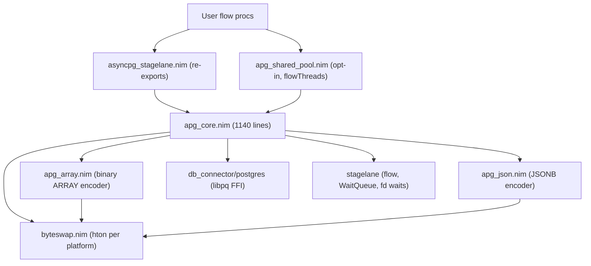

# asyncpg-stagelane: review and refactoring plan

## 1. Architecture summary

This is a libpq-based async PostgreSQL driver, forked from cheatfate/asyncpg and ported to the stagelane runtime. Async procs are written as `{.flow.}` procs, socket readiness uses `waitReadable`/`waitWritable` on `PQsocket`, and waiters use `WaitQueue` + `park`/`parkSince`/`notifyOne`.



What `apg_core.nim` does today, in one file:
- extra libpq FFI and the dylib name
- the types `ApgConnection`, `ApgResult`, `ApgPool`, `NotifyWait`, `ApgNotifyCell`
- connect/reset polling
- `ApgPool` checkout/checkin
- the query pump (`execAsync`) and COPY in/out
- row extraction
- the `exec` macro, which compiles Nim-typed parameters into binary `PQsendQueryParams` arrays with OIDs
- LISTEN/NOTIFY routing
- escaping

There are two pools:
- `ApgPool` is single-thread and has no locks.
- `ApgSharedPool` uses a `Lock` plus a slot state machine `ssEmpty/ssIdle/ssBusy/ssConnecting` and relies on stagelane's cross-thread wakeups. It re-declares `exec`, the notify ops and `withConnection`.

## 2. Problem areas

### A. Correctness bugs (high severity)
1. **Error path always crashes.** In `checkResultCommand` and `checkResultTuple` ([apg_core.nim](asyncpg_stagelane/apg_core.nim) 1001-1011 and [apg_shared_pool.nim](asyncpg_stagelane/apg_shared_pool.nim) 255-265), `close(res)` empties `pgress`, and then `res.pgress[0].conn` is read. The result is an IndexDefect instead of the real SQL error. Even with bounds checks off, it reads a freed `PGresult`.
2. **Double free.** `getRow` calls `pqclear(pgres)` (line 505), but the `PGresult` is still owned by `ApgResult`, so a later `close(res)` frees it again.
3. **Plain connections are poisoned after any SQL error.** When `execAsync` (lines 420-421) sees an error result, it raises without draining the remaining results. On a bare `ApgConnection` the next command then fails with "another command is already in progress". It also leaks both the failing `PGresult` and the results collected so far. It reports `pqerrorMessage(conn)` instead of the result's own error.
4. **Shared pool: double checkout race.** In the `execSharedPoolAsync` error path (lines 227-234), the slot is set to `ssEmpty` under the lock and then `checkin` runs, which sets `ssEmpty` again. In between, another thread can reserve the slot (`ssConnecting`). The second reset lets a third thread reserve the same slot, so two tasks end up with the same index.
5. **Shared pool: lock destroyed while still in use.** `close` calls `deinitLock` (line 201), but the docs promise that busy slots are closed at `checkin`, and `checkin` acquires that lock. That is undefined behaviour.
6. **`exec` macro: unsafe string and bytea parameters.** It takes `addr param[0]` (lines 924, 826):
   - An empty `string` or `seq[char]` crashes.
   - Expressions that are not lvalues (`a & b`, `f()`) fail to compile.
   - `Json` and `JsonB` use `param[1]` (lines 943, 949), which assumes a literal conversion call. Passing a variable of type `Json` breaks.
7. **Resource leaks on exception.** `PgArray`/`PgJson` buffers are freed by `postNodes` after the call, so they leak if `exec` raises. `newPgArray[string]` raises after `alloc` (line 86) and leaks the buffer.
8. **COPY end can block the event loop.** In `copyTo`, when `putRes == 1` (lines 255-270), the code calls `pqgetResult` without flushing or consuming input first. After `PQputCopyEnd`, libpq then waits synchronously for the server.
9. **SQL injection** through `LISTEN "` & channel & `"` (lines 1018-1046 and 268-275) and `setClientEncoding` (line 546).
10. **Smaller bugs:**
    - `getAffectedRows` raises on an empty `cmdTuples` (for example after a SELECT).
    - `PgArray.len` does not byteswap.
    - `PgJson.$` reads an int8 header as int32.
    - `byteswap` maps `uint` to `uint32` on 16-bit ints.
    - `uint64` silently becomes `int8`, so values above 2^63 overflow.

### B. Duplicated code
- connect and reset use near-identical poll loops (lines 98-110 and 131-145).
- `execAsync` and `copyTo` share the same flush/consume/getResult pump (lines 272-302 and 396-427).
- `listenNotify`, `unlistenNotify` and `sendNotify` are written three times (connection, `ApgPool`, `ApgSharedPool`). The two `checkResult*` templates and `withConnection` are written twice.
- `notify` registration is written twice.
- `exec` exists as three macros because dispatch is passed in as a string, not resolved by overloading.
- The OID/size mapping exists three times: `getOidSimple`, `getOidArray` and `newPgArray`.
- `byteswap.nim` is about 200 lines of per-OS copies of the same three intrinsics. One of them (Windows gcc using `<x86intrin.h>`) breaks on ARM.
- Each branch of the `exec` macro repeats the same four `.add` calls. There are about 15 one-line NimNode helpers that `quote do` would replace.

### C. Performance bottlenecks
- **Every SQL error drops and reconnects a pooled connection** (`execPoolAsync` and `execSharedPoolAsync`). Under an error storm, each failed query costs a TCP/TLS/auth round trip. After the drain fix in A3, a connection only needs to be dropped when it is unhealthy or its transaction status is not idle.
- `connect(pool)` opens slots one after another, so startup takes N round trips.
- NOTIFY routing scans linked lists in O(waiters x notifies). Waiters that time out are never unregistered, so `notifies` grows without bound and dead waiters consume real NOTIFYs.
- `notices` grows forever and has no public reader, which is a memory leak on long-lived connections.
- Row extraction uses `$cstring`, which calls strlen per cell, even though `pqgetlength` already knows the length. Under ARC, `rows` copies the reused seq on `yield`.
- Each array or JSONB parameter is `alloc`ed and freed by hand.

### D. Maintainability risks
- `apg_core.nim` is a 1140-line module with seven responsibilities.
- Every error is a `ValueError` with no SQLSTATE.
- Ownership is manual everywhere: `close` on results, `free` on arrays. `close(conn)` raises when called twice, so `close(pool)` can raise as well.
- `connections*` is public in both pools, which invites borrowing a connection outside checkout.
- `apg_shared_pool` re-exports `apg_core except exec` and re-declares the connection `exec` so it is not hidden. This is fragile.
- NULL and `""` cannot be told apart, even though the docs say NULL becomes nil.
- `malebolgia` is a runtime `requires`, although only tests use it. The test list in the `justfile` is hard-coded and drifts from the `test-build` glob.

## 3. Refactoring strategy (phased; each phase builds and passes `just test`)

**Phase 1: correctness (no API change)**
- Fix A1-A10.
- Add a regression test for each fix in a new `tests/test_regressions.nim` and register it in the `justfile`.

**Phase 2: deduplication**
- Add a shared result pump `drainResults`.
- Add one `pollUntilReady` used by connect and reset.
- Generate the notify ops once with a template.
- Use a single `exec` macro that dispatches by overloading `execDispatch`.
- Keep a single `withConnection`.
- Keep the OID tables in one module.
- Rewrite `byteswap.nim` as one generic `hton`.

**Phase 3: module split and API hardening (some breaking changes)**
- Split the code into these modules, keeping `apg_core.nim` as a re-export facade so existing imports still work:
  - `apg_ffi`
  - `apg_errors`
  - `apg_types` (OIDs)
  - `apg_conn`
  - `apg_result`
  - `apg_params` (the `exec` macro)
  - `apg_notify`
  - `apg_pool`
  - `apg_escape`
- Add an `ApgError` hierarchy with `sqlState`.
- Give `ApgResult`, `ApgConnection` and `PgArray`/`PgJson` an `=destroy`. `close` stays as an idempotent early release.
- Make `connections` private and expose a `connectionAt` accessor.
- Add `cancel(w: NotifyWait)` and a `Table[string, seq[NotifyWait]]` registry.
- Add `takeNotices(conn)` with a cap.
- Make pool connect concurrent with `go`.
- Add `isNull` and `getValueOpt`.
- Move `malebolgia` into the test requirements.
- Update the README to cover the new errors, auto-destroy, `cancel` and NULL handling.

## 4. Improved code (key pieces)

**Error type and a single raise point** (`apg_errors.nim`):

```nim
type
  ApgError* = object of CatchableError
  ApgConnectionError* = object of ApgError
  ApgQueryError* = object of ApgError
    sqlState*: string

proc raiseConnError*(c: PPGconn) {.noreturn.} =
  raise newException(ApgConnectionError, $pqerrorMessage(c))

proc raiseResultError*(r: PPGresult) {.noreturn.} =
  ## Takes ownership of `r` (clears it) before raising.
  let e = newException(ApgQueryError, $pqresultErrorMessage(r))
  e.sqlState = $pqresultErrorField(r, 'C'.int32)  # PG_DIAG_SQLSTATE
  pqclear(r)
  raise e
```

**One result pump.** It replaces the loops in `execAsync` and `copyTo` and fixes A3 and A8 by always draining:

```nim
proc flushOutgoing(conn: ApgConnection, fd: int) {.flow.} =
  while true:
    let fr = pqflush(conn.pgconn)
    if fr < 0: raiseConnError(conn.pgconn)
    if fr == 0: return
    waitWritable(fd)

proc drainResults(conn: ApgConnection, notifyConn: bool,
                  res: ApgResult) {.flow.} =
  ## Pumps libpq until the command completes (or enters COPY). Keeps draining
  ## after an error result so the connection stays usable; raises it at the end.
  let fd = socketFd(conn.pgconn)
  var firstErr: PPGresult = nil
  while true:
    flushOutgoing(conn, fd)
    if pqconsumeInput(conn.pgconn) == 0: raiseConnError(conn.pgconn)
    processPendingNotifications(conn, notifyConn)
    while pqisBusy(conn.pgconn) == 0:
      let r = pqgetResult(conn.pgconn)
      if r == nil:
        if firstErr != nil: raiseResultError(firstErr)
        return
      case pqresultStatus(r)
      of PGRES_EMPTY_QUERY, PGRES_COMMAND_OK, PGRES_TUPLES_OK:
        res.pgress.add r
      of PGRES_COPY_IN, PGRES_COPY_OUT:
        res.pgress.add r
        return
      else:
        if firstErr == nil: firstErr = r else: pqclear(r)
    waitReadable(fd)
```

After this, `copyTo` is "put data or end, then `drainResults`", and `execAsync` is "send, then `drainResults`". Already-collected results are released by the `ApgResult` destructor.

**Unified connect/reset polling:**

```nim
template pollUntilReady(conn: ApgConnection, pollCall: untyped) =
  while true:
    let fd = socketFd(conn.pgconn)
    case pollCall
    of PGRES_POLLING_READING: waitReadable(fd)
    of PGRES_POLLING_WRITING: waitWritable(fd)
    of PGRES_POLLING_OK: break
    of PGRES_POLLING_FAILED: raiseConnError(conn.pgconn)
    else: raise newException(ApgConnectionError, "unexpected poll state")
# connect: pollUntilReady(conn, pqconnectPoll(conn.pgconn))
# reset:   pollUntilReady(conn, pqresetPoll(conn.pgconn))
```

**Fixed result check (A1) and identifier quoting (A9):**

```nim
proc expectStatus*(res: ApgResult, want: ExecStatusType) =
  let st = pqresultStatus(res.pgress[0])
  let msg = $pqresultErrorMessage(res.pgress[0])   # read BEFORE close
  close(res)
  if st != want: raise newException(ApgQueryError, msg)

func quoteIdent*(s: string): string =
  if '\0' in s: raise newException(ValueError, "NUL in identifier")
  '"' & s.replace("\"", "\"\"") & '"'
```

**Notify ops written once** for every handle type. The sender uses `pg_notify($1,$2)`, so it is already injection-safe:

```nim
template defineNotifyOps*(T: typedesc) =
  proc listenNotify*(c: T, channel: string) {.flow.} =
    expectStatus(exec(c, "LISTEN " & quoteIdent(channel)), PGRES_COMMAND_OK)
  proc unlistenNotify*(c: T, channel: string) {.flow.} =
    expectStatus(exec(c, "UNLISTEN " & quoteIdent(channel)), PGRES_COMMAND_OK)
  proc sendNotify*(c: T, channel, payload: string) {.flow.} =
    doAssert payload.len < 8000
    expectStatus(exec(c, "SELECT pg_notify($1, $2)", channel, payload),
                 PGRES_TUPLES_OK)

defineNotifyOps(ApgConnection)
defineNotifyOps(ApgPool)          # apg_shared_pool: defineNotifyOps(ApgSharedPool)
```

I still need to check that stagelane's `{.flow.}` pragma macro expands correctly inside a template. If it does not, the fallback is generic procs over `ApgConnection | ApgPool`.

**Single `exec` macro.** `apgExecImpl` emits an unbound `ident"execDispatch"`, so `apg_shared_pool` only needs to add an overload. Its re-declared `exec` macros and the `export apg_core except exec` go away:

```nim
# apg_shared_pool.nim
proc execDispatch*(pool: ApgSharedPool, statement: string, pN: int32, pT: POid,
                   pV: cstringArray, pL, pF: ptr int32,
                   rF: int32): ApgResult {.flow.} = ...
```

**Safe string, bytea and JSON parameters (A6).** The value is always bound to a local first, and the pointer comes from `cstring` or `unsafeAddr` with no `[0]`:

```nim
of ntyString, ntyCString:
  result.add quote do:
    var `np` = `param`          # handles literals, calls, `a & b`
  addParam(quote do: cast[pointer](cstring(`np`)),
           quote do: int32(len(`np`)), 25, 1)
of ntyDistinct:   # Json / JsonB
  let inner = quote do: JsonNode(`param`)   # works for variables, not just Json(x)
```

The repeated four-line `.add` blocks become one helper:

```nim
proc addParam(value, length: NimNode; oid, fmt: int) =
  valuesList.add value; lensList.add length
  typesList.add newDotExpr(newLit oid, ident"Oid"); formatsList.add newLit(fmt.int32)
```

**One OID table** (`apg_types.nim`) is used by both the macro and `newPgArray`:

```nim
func pgScalarOid*(k: NimTypeKind): tuple[oid, size: int] {.compileTime.}
func pgArrayOid*(k: NimTypeKind): int {.compileTime.}
template elemOid*(T: typedesc): int32   # generic-side twin, built from the same table
```

**`byteswap.nim` in about 20 lines**, replacing more than 200:

```nim
when defined(gcc) or defined(clang) or defined(llvm_gcc):
  func bswap32(x: uint32): uint32 {.importc: "__builtin_bswap32", nodecl.}
  func bswap64(x: uint64): uint64 {.importc: "__builtin_bswap64", nodecl.}
elif defined(vcc):
  func bswap32(x: uint32): uint32 {.importc: "_byteswap_ulong", header: "<stdlib.h>".}
  func bswap64(x: uint64): uint64 {.importc: "_byteswap_uint64", header: "<stdlib.h>".}
else:
  func bswap32(x: uint32): uint32 = (x shl 24) or ((x and 0xFF00'u32) shl 8) or
    ((x shr 8) and 0xFF00'u32) or (x shr 24)
  func bswap64(x: uint64): uint64 =
    (uint64(bswap32(uint32(x))) shl 32) or uint64(bswap32(uint32(x shr 32)))

template hton*[T: SomeNumber | bool | char](x: T): T =
  when cpuEndian == bigEndian or sizeof(T) == 1: x
  elif sizeof(T) == 2: cast[T]((cast[uint16](x) shr 8) or (cast[uint16](x) shl 8))
  elif sizeof(T) == 4: cast[T](bswap32(cast[uint32](x)))
  else: cast[T](bswap64(cast[uint64](x)))

template prepare*[T](x: T): T {.deprecated: "use hton".} = hton(x)
```

**RAII ownership** (Phase 3). This fixes A7 and removes the `close`/`free` boilerplate:

```nim
type
  ApgResultObj = object of RootObj
    pgress: seq[PPGresult]
  ApgResult* = ref ApgResultObj

proc `=destroy`(r: ApgResultObj) =
  for p in r.pgress: pqclear(p)

proc close*(r: ApgResult) =          # idempotent early release
  for p in r.pgress: pqclear(p)
  r.pgress.setLen(0)

proc `=destroy`(a: PgArray) = (if a.p != nil: dealloc(a.p))
proc `=copy`(d: var PgArray, s: PgArray) {.error.}
```

The same pattern applies to `ApgConnection`: `=destroy` calls `pqfinish` if the handle is not nil. That also closes the dangling `noticeReceiver` pointer hazard.

**Shared pool fixes (A4, A5, and C1):**

```nim
# execSharedPoolAsync: never touch slot state outside checkin
  try:
    result = execAsync(pool.connections[index], ...)   # now drains on SQL errors
    withPoolLock pool: forwardConnNotifiesToPool(...)
  finally:
    checkin(pool, index)  # shouldDiscardConn decides: broken or non-idle xact -> drop

# close: do not deinit the lock; busy borrowers still call checkin
proc `=destroy`(p: ApgSharedPoolObj) = deinitLock(p.lock)
```

`checkin` also moves `close(conn)` (`pqfinish`) out of the critical section, the same way `close(pool)` already does. `pool.connStr` is written under the lock.

**Rows without strlen, with NULL awareness:**

```nim
proc cellString(r: PPGresult, row, col: int32): string {.inline.} =
  let n = pqgetlength(r, row, col)
  result = newString(n)
  if n > 0: copyMem(addr result[0], pqgetvalue(r, row, col), n)

proc isNull*(r: PPGresult, row = 0, col = 0): bool =
  pqgetisnull(r, row.int32, col.int32) == 1
```

## 5. Regression tests to add (`tests/test_regressions.nim`)
- `getRow` followed by `close(res)`, which must not double free.
- An SQL error on a bare `ApgConnection`, then `SELECT 1` on the same connection, which must succeed.
- A failing LISTEN or UNLISTEN path that raises `ApgQueryError` with a `sqlState`.
- Empty `""` and `@[]` byte parameters; a `Json` variable parameter; a call-expression string parameter.
- A channel name containing `"`.
- Shared pool: `close` while a task is busy, then checkin, with no crash. Also an error storm under `test_torture_mt` with no duplicate PIDs and no reconnect per error, checked through backend PID stability.
- `NotifyWait` cancel, so a timed-out waiter no longer consumes the NOTIFY.

Verification: use LSP/ReadLints for compile checks during edits and run only the targeted test binaries. Run `just test` once at the end of each phase.
