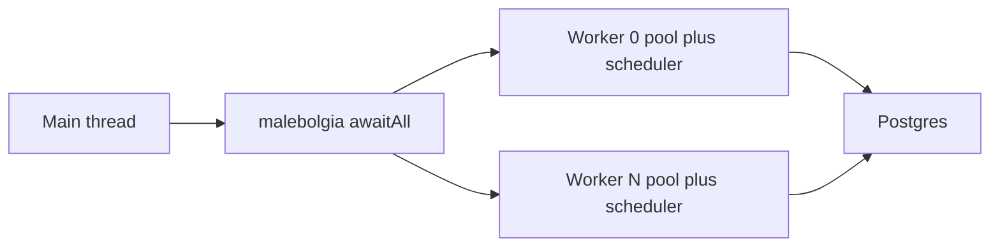

# Multi-threaded tests with malebolgia

The current suite, including [tests/test_torture.nim](tests/test_torture.nim), runs on one stagelane scheduler. That scheduler is a threadvar (`theSched` in [deps/stagelane/src/stagelane/sched.nim](deps/stagelane/src/stagelane/sched.nim)), and an `apgPool` is unsynchronized (`busy`, `waitq`, libpq handles in [asyncpg_stagelane/apg_core.nim](asyncpg_stagelane/apg_core.nim)). Libpq allows many connections in parallel and forbids sharing one `PGconn` across threads.

So each malebolgia worker creates its own pool, calls `run` on that thread, and closes the pool before returning. Workers do not share `apgPool`, `apgConnection`, or stagelane tasks. Inner concurrency stays `go` / `park` on that thread. Workers do not call `createMaster` again: malebolgia’s pool is fixed, and a nested `awaitAll` can stall once every worker is blocked inside `run`.

## Dependency

Add `requires "malebolgia >= 1.3.2"` to [asyncpg_stagelane.nimble](asyncpg_stagelane.nimble) (package index name; repo is [Araq/malebolgia](https://github.com/Araq/malebolgia)). Run `atlas install` so [nim.cfg](nim.cfg) gains `--path:"deps/malebolgia/src"` and [atlas.lock](atlas.lock) records the commit. Update the requires block in [docs/atlas.md](docs/atlas.md) to match.

In [tests/config.nims](tests/config.nims), set `--threads:on` and `-d:ThreadPoolSize=4`. Do not define `flowThreads`: that switches stagelane to its own cross-thread mailbox, which these tests do not use.

Import `malebolgia except cancel` anywhere stagelane’s task `cancel` is in scope.

## Shared scenarios

Move the seven scenarios out of [tests/test_torture.nim](tests/test_torture.nim) into `tests/torture_lib.nim` (no top-level `run`, so it is importable). Parameterize what the MT run must not share:

- pool size, task counts, sleeps, timeout
- counter table name (today every run uses `torture_counter`)
- NOTIFY channel (today `torture_notify_ch`)

[tests/test_torture.nim](tests/test_torture.nim) becomes a thin driver with the current knobs and names, so single-thread behavior stays the same. `test-build` already compiles every `tests/*.nim`; `torture_lib.nim` has no top-level entry and must not be added to `test-run`. If compiling it as a program fails the glob, give it an empty `when isMainModule` stub rather than changing the glob.

## New binaries

**[tests/test_mt.nim](tests/test_mt.nim)** — four workers, no long sleeps. Each receives the connection string as a `spawn` argument (`connStr` is a managed global and is not `gcsafe` to read). Each worker: one `apgConnection` and `SELECT 1`; then a pool of 4 and a handful of overlapping `SELECT $1::int` tasks that must read back their own values; then `close`. `createMaster` plus `awaitAll`. A raised `CatchableError` fails the binary after `awaitAll`.

**[tests/test_torture_mt.nim](tests/test_torture_mt.nim)** — same four workers, smaller knobs than the single-thread file (pool 2, fewer tasks, shorter `pg_sleep`) so `just test` does not grow by a full extra torture run. Each worker runs scenarios 1–5 and 7 from `torture_lib` on a private pool, with table `mt_counter_<id>` and channel `mt_notify_<id>`.

Two extra scenarios that use Postgres as the only shared state:

- **Cross-thread counter.** Main thread creates one row. Each worker increments it `K` times through its own pool (`BEGIN` / `UPDATE` / `COMMIT`). After `awaitAll`, `n = threads * K`.
- **Cross-thread NOTIFY.** One worker `LISTEN`s, then inserts a ready row. The others poll that row, then `sendNotify` distinct payloads. The listener drains until every payload arrives. Per-connection NOTIFY is not queued before `LISTEN`, so the ready row is the barrier. Channel name is distinct from the per-thread scenario.

Per-thread `waitFor` stays, with the scenario name and worker id in the assert text. A lost wakeup fails the binary instead of hanging the recipe.

Wire both binaries into the explicit list in [justfile](justfile) `test-run`.

## Fix policy

Run `just test`. Expected result is green without driver changes: this stresses many schedulers and many libpq connections, not one pool from several threads. If a worker fails, fix the invariant that scenario names (checkout, cancel, NOTIFY fan-out, reconnect). Do not add locks to `apgPool` so a pool can be shared across malebolgia threads.
