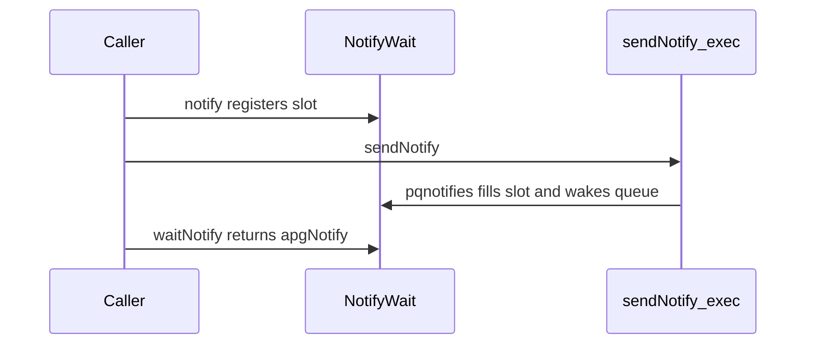

# Port asyncpg off asyncdispatch onto stagelane

The PostgreSQL surface stays: connect, reset, close, pooled exec, COPY, LISTEN/NOTIFY, encodings, and the `exec` parameter macro. What changes is the concurrency model. [stagelane](file:///Users/alexboisvert/nim/stagelane) has no `Future`, `await`, or `addRead`. A `{.flow.}` proc pauses on `waitReadable`, `waitWritable`, `park`, or `delay`, and a direct call from ordinary code drives the event loop until it returns. Concurrent work is `go`, not “call an async proc and hold the future.”

`asyncdispatch` is used only in [`asyncpg_stagelane/apg_core.nim`](asyncpg_stagelane/apg_core.nim) and the five integration tests. [`apg_array.nim`](asyncpg_stagelane/apg_array.nim), [`apg_json.nim`](asyncpg_stagelane/apg_json.nim), and [`byteswap.nim`](asyncpg_stagelane/byteswap.nim) stay as they are. `db_connector/postgres` does not import `asyncdispatch`.

## Caller-facing shape

Suspending operations become `{.flow.}` procs that return the value (or raise `ValueError`) instead of `Future[T]`:

- `connect(connection): apgConnection`
- `reset(conn)`
- `connect(pool, connection)`, `setClientEncoding`, `listenNotify`, `unlistenNotify`, `sendNotify`
- `copyTo(...): apgResult`, `copyFromInto(...): int`
- `exec(...)` macro result type becomes `apgResult` (it still expands to `execAsync` / `execPoolAsync`)

`close`, row helpers, encoding getters, and `escape*` stay synchronous.

Parallel work uses stagelane tasks. The pool test’s `futs[i] = makeLongCall(pool)` becomes `go makeLongCall(pool)`. `waitFor` at program top level becomes a direct call (`connect` and the test proc already run the loop). `sleepAsync` plus `future or` becomes `waitFor(task, ms)` (`true` when the task finished). `future.finished` becomes `done(task)`.

`notify` cannot stay a single suspending call. `go` only schedules; it does not run the new task before returning, so a waiter registered inside the task would miss a NOTIFY already consumed by `sendNotify`. Today `notify` registers the future before it returns. Keep that:

- `notify(conn|pool, channel): NotifyWait` is an ordinary proc. It appends a waiter immediately.
- `waitNotify(w): apgNotify {.flow.}` parks until a later query on that connection pumps the NOTIFY (`pqnotifies` is still only called from the exec/COPY read loop, which is the current behavior).
- Delivery stores the payload on the slot and `notifyOne`s its queue, even if nobody is parked yet. `waitNotify` then returns without blocking.

Users import `stagelane` themselves for `go`, `run`, `waitFor`, and `delay`. This package will not re-export the runtime.

## Libpq poll loops

Delete `AsyncFD`, `register`, `unregister`, `addRead`, and `addWrite`. Stagelane takes the raw `PQsocket` int and registers interest only while a task is inside `waitReadable` / `waitWritable`. After the wait returns, the fd is dropped. `close` of an idle connection can keep calling `pqfinish` with no dispatcher teardown. Only one reader and one writer may wait on a given fd; one in-flight operation per connection matches libpq, and the pool already guarantees that.

Rewrite the callback state machines as loops:

- `connect` / `reset`: `PQconnectStart` + `PQconnectPoll`, or `PQresetStart` + `PQresetPoll`, alternating `waitReadable` and `waitWritable` until `PGRES_POLLING_OK` or failure. Keep non-blocking mode, verbose errors, the notice receiver, and the notify list on success.
- `execAsync` and `copyTo`: `PQflush` until it returns 0 (read-ready vs write-ready), then `PQconsumeInput`, `processPendingNotifications`, and `PQisBusy` / `PQgetResult`. When the connection is still busy, `waitReadable` again. That is the old callback’s `return false` (“stay interested in read”).
- `copyFromInto`: `PQgetCopyData` in a loop; `0` means `waitReadable` and retry.

Raise the same `ValueError` messages instead of `retFuture.fail`.

## Pool checkout

Replace `seq[Future[void]]` and the `.callback = cb` thundering herd with the same pattern as stagelane’s semaphore: a `busy` flag per slot and one `WaitQueue`.

- `checkout(pool): int {.flow.}` scans for a free slot; if none, `park`s and retries.
- `checkin` clears the flag and `notifyOne`s.
- `withConnection` stays an inlining template (the `do:` body is still pasted into the caller) but uses `checkout` / `try` / `finally: checkin` instead of `yield future`. The caller must be `{.flow.}` when the body pauses. `flowTransform` sees the expanded `checkout` call.
- `execPoolAsync` checks out, runs `execAsync(..., notify = false)`, moves connection-queued NOTIFY payloads onto matching pool slots, then checkin in `finally`.

Cancellation: a cancelled task cannot reliably `reset` later, because the next park raises `CancelledError` again. On an exception from an in-flight query, `finally` calls synchronous `pqfinish`, stores `nil` in that slot, and checkin. The next `checkout` of a nil slot calls `connect` with the DSN, so store the connection string on the pool in `connect(pool, ...)`.

## NOTIFY lists

Keep `DoublyLinkedList`, but store a slot (`channel`, `arrived`, `apgNotify`, `WaitQueue`) instead of `Future[apgNotify]`.

- Connection exec (`notify = true`): if a slot for that channel is waiting, fill it and wake it. Unmatched NOTIFYs are still dropped.
- Pool exec (`notify = false`): queue the payload on the connection, then after the query match it to pool slots the same way `execPoolAsync` does now (including the current “remove pool nodes while scanning” behavior, so the notify tests keep their meaning).

## Dependency and docs

- [`asyncpg_stagelane.nimble`](asyncpg_stagelane.nimble): `requires "stagelane >= 0.1.0"` next to `db_connector`. Sibling checkout is [`/Users/alexboisvert/nim/stagelane`](/Users/alexboisvert/nim/stagelane); local builds need that package on the Nim path (`nimble develop` or an equivalent path). Do not vendor it.
- [`README.md`](README.md): show `{.flow.}` calls without `await`, `go` for overlapping queries, and `notify` + `waitNotify`. State that sockets follow stagelane, which is POSIX-only, and that a connection must be used on the thread whose scheduler is driving it.
- Tests: drop `import asyncdispatch` from [`tests/test_types.nim`](tests/test_types.nim), [`tests/test_rows.nim`](tests/test_rows.nim), [`tests/test_utils.nim`](tests/test_utils.nim), [`tests/test_pool.nim`](tests/test_pool.nim), and [`tests/test_notifies.nim`](tests/test_notifies.nim). Mark test procs `{.flow.}`. In the notify tests, arm with `notify`, send, then `waitFor(go waitNotify(slot), 100)`. In the pool test, `go` the long calls and use `done`.

## Verification

- `rg asyncdispatch` over the repo returns no hits.
- Compile and run the existing suite with `just test` (Postgres via the justfile). That covers types, rows, COPY, encodings, pool concurrency, `withConnection`, and NOTIFY.
- No new unit-test framework. If a flow proc fails to compile because a suspension sits inside a macro-generated expression, pull that call into a `let` at the call site; the `exec` macro itself should stay a statement-list expression whose last call is `execAsync`.
